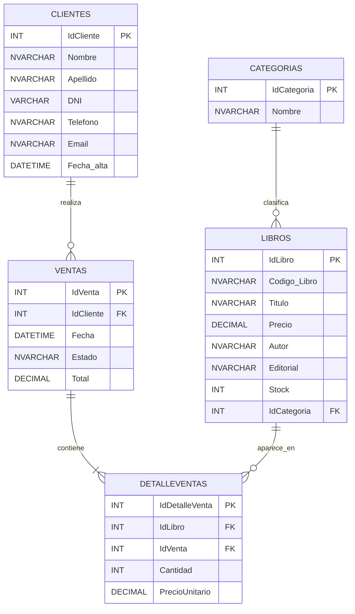

# 📚 EntrePáginas
## Sistema de Gestión de Ventas para una Librería

**Instituto Superior Villa del Rosario**  
**Carrera:** Tecnicatura Superior en Desarrollo de Software  
**Materia:** Programación II — Ciclo 2026  
**Docente:** Lic. Romina Laura Frandino  
**Trabajo:** Parcial 4 — Trabajo Final Integrador

---

## 1. Descripción del proyecto

EntrePáginas es un sistema web desarrollado para gestionar las ventas de una librería.

El objetivo es facilitar el registro de ventas, la búsqueda de libros, el control del stock, el seguimiento de los pedidos y la consulta de estadísticas.

El proyecto integra una base de datos SQL Server, un backend desarrollado con Node.js y Express, y un frontend realizado con HTML, CSS y JavaScript.

## 2. Integrantes y distribución del trabajo

El proyecto fue desarrollado de manera grupal por tres integrantes:

| Integrante | Rama de GitHub | Responsabilidades |
|---|---|---|
| Maia | `rama-maia` | Desarrollo de las tres páginas HTML. Participación en la base de datos y el backend. |
| Jeremías | `rama-jere` | Desarrollo de los estilos CSS. Participación en la base de datos y el backend. |
| Nicolás | `rama-nicolas` | Desarrollo del JavaScript del frontend, componentes y reorganización de `app.js`. Participación en la base de datos y el backend. |

Los tres integrantes participaron en el diseño de las tablas, la carga de datos y los procedimientos almacenados de SQL Server.

También se distribuyeron las funcionalidades del backend, trabajando sobre rutas, controladores, servicios y middlewares.

Para organizar el desarrollo se utilizaron ramas individuales, commits y GitHub como repositorio compartido.

## 3. Tecnologías utilizadas

**Base de datos**
- SQL Server
- SQL Server Management Studio
- Procedimientos almacenados con T-SQL

**Backend**
- Node.js
- Express
- Librería `mssql` para conectar con SQL Server
- `dotenv` para las variables de entorno
- `cors` para permitir solicitudes entre distintos orígenes
- `nodemon` para el desarrollo

**Frontend**
- HTML5
- CSS3
- JavaScript vanilla
- ES Modules
- Fetch API
- Componentes JavaScript reutilizables
- SweetAlert2 para notificaciones y confirmaciones

**Control de versiones**
- Git
- GitHub
- Ramas individuales de desarrollo

## 4. Funcionalidades principales

### Nueva venta — `index.html`

- Consultar el catálogo de libros.
- Buscar libros por texto y categoría.
- Visualizar precios, autores, editoriales y disponibilidad.
- Seleccionar un cliente.
- Agregar y quitar libros del pedido.
- Modificar cantidades.
- Controlar que no se supere el stock disponible.
- Registrar una venta.
- Actualizar el catálogo después del registro.

### Gestión de ventas — `tablero.html`

- Consultar las ventas registradas.
- Buscar por cliente.
- Filtrar por estado y rango de fechas.
- Visualizar el importe y estado de cada venta.
- Cambiar el estado de En preparación a Listo y luego a Entregado.
- Cancelar ventas en preparación.
- Devolver las unidades al stock cuando se cancela una venta.

### Estadísticas — `estadisticas.html`

- Consultar las ventas agrupadas por categoría.
- Visualizar la cantidad de ventas.
- Consultar las unidades vendidas.
- Visualizar los importes totales.
- Actualizar los resultados sin recargar la página.

## 5. Base de datos

La base de datos se llama `EntrePaginasDB` y contiene cinco tablas principales.

| Tabla | Función |
|---|---|
| `Categorias` | Almacena las categorías de los libros. |
| `Libros` | Guarda los datos, precios y stock de los libros. |
| `Clientes` | Almacena los datos de los clientes. |
| `Ventas` | Registra las ventas, sus fechas, totales y estados. |
| `DetalleVentas` | Guarda los libros y cantidades correspondientes a cada venta. |

Las tablas se relacionan mediante claves primarias y foráneas.

Las operaciones de negocio se realizan mediante procedimientos almacenados, incluyendo `usp_RegistrarVenta` y `usp_CambiarEstadoVenta`.

Las validaciones importantes, el cálculo de importes y las operaciones de stock se realizan en SQL Server.


### Diagrama Entidad-Relación (DER)

El siguiente diagrama representa la estructura de la base de datos `EntrePaginasDB`, sus cinco tablas principales y las relaciones mediante claves primarias (PK) y claves foráneas (FK).



### Explicación de las relaciones

- **Categorias → Libros (1:N):** una categoría puede contener muchos libros, pero cada libro pertenece a una sola categoría.
- **Clientes → Ventas (1:N):** un cliente puede realizar muchas ventas, pero cada venta corresponde a un solo cliente.
- **Ventas → DetalleVentas (1:N):** una venta contiene uno o varios renglones de detalle.
- **Libros → DetalleVentas (1:N):** un libro puede aparecer en los detalles de muchas ventas.

La tabla `DetalleVentas` permite resolver la relación de muchos a muchos (N:M) entre libros y ventas, registrando también la cantidad y el precio unitario de cada libro vendido.


## 6. Organización del proyecto

```text
EntrePaginas/
├── back/
│   ├── src/
│   │   ├── config/
│   │   ├── controllers/
│   │   ├── middlewares/
│   │   ├── routes/
│   │   ├── services/
│   │   └── server.js
│   ├── .env.example
│   └── package.json
│
├── base de datos/
│   └── script_completo.sql
│
├── front/
│   ├── css/
│   │   ├── index.css
│   │   ├── tablero.css
│   │   └── estadisticas.css
│   ├── js/
│   │   ├── componentes/
│   │   │   ├── comun.js
│   │   │   ├── estadoVenta.js
│   │   │   ├── filaEstadistica.js
│   │   │   ├── filaVenta.js
│   │   │   ├── resumenVenta.js
│   │   │   └── tarjetaLibro.js
│   │   ├── api.js
│   │   └── app.js
│   ├── index.html
│   ├── tablero.html
│   └── estadisticas.html
│
└── README.md
```

## 7. Requisitos para ejecutar el sistema

Se necesita tener instalado:

- Node.js y npm.
- SQL Server.
- SQL Server Management Studio o una herramienta equivalente.
- Visual Studio Code o un editor de código.
- Un navegador web.
- Live Server para ejecutar el frontend con la configuración actual.

## 8. Instalación y ejecución paso a paso

### Paso 1. Clonar el repositorio

Abrir una terminal y ejecutar:

```bash
git clone https://github.com/maiacabrera59-oss/EntrePaginas.git
cd EntrePaginas
```

### Paso 2. Crear la base de datos

Abrir SQL Server Management Studio y conectarse al servidor SQL Server.

Abrir el archivo:

```text
base de datos/script_completo.sql
```

Ejecutar el script completo.

Este archivo crea la base de datos `EntrePaginasDB`, las tablas, las relaciones, los datos de ejemplo y los procedimientos almacenados.

### Paso 3. Instalar las dependencias del backend

Desde la raíz del repositorio:

```bash
cd back
npm install
```

### Paso 4. Configurar las variables de entorno

Dentro de `back`, crear un archivo llamado `.env` a partir de `.env.example`.

Ejemplo de configuración:

```env
PORT=3000
DB_SERVER=localhost
DB_DATABASE=EntrePaginasDB
DB_USER=prog2
DB_PASSWORD=REEMPLAZAR_CON_PASSWORD_LOCAL
DB_ENCRYPT=false
DB_TRUST_CERT=true
```

En caso de utilizar una instancia SQL Server nombrada, puede ser necesario agregar:

```env
DB_INSTANCE=SQLEXPRESS
```

Los valores deben adaptarse a la instalación local de SQL Server.

**Importante:** el archivo `.env` contiene configuraciones privadas y no debe subirse a GitHub.

### Paso 5. Iniciar el backend

Desde la carpeta `back`, ejecutar:

```bash
npm start
```

Para desarrollo también se puede utilizar:

```bash
npm run dev
```

El backend utiliza por defecto el puerto 3000.

Con el servidor iniciado, se puede comprobar su respuesta en:

```text
http://localhost:3000/
```

La ruta principal responde con un mensaje indicando que la API está funcionando.

### Paso 6. Abrir el frontend

Con la configuración actual del proyecto, abrir la carpeta `front` en Visual Studio Code y ejecutar `index.html` con Live Server.

Las páginas disponibles son:

```text
http://127.0.0.1:5500/front/index.html
http://127.0.0.1:5500/front/tablero.html
http://127.0.0.1:5500/front/estadisticas.html
```

Estas direcciones suponen que Live Server se inicia desde la raíz del repositorio y utiliza el puerto 5500.

El frontend realiza las solicitudes al backend en `http://localhost:3000/api`.

Para la entrega final se debe verificar la configuración solicitada por la cátedra, donde Express también sirve el frontend desde el puerto 3000.

## 9. Endpoints de la API

La API utiliza como dirección base:

```text
http://localhost:3000/api
```

| Método | Endpoint | Función |
|---|---|---|
| GET | `/categorias` | Lista las categorías disponibles. |
| GET | `/clientes` | Lista los clientes. |
| GET | `/libros` | Lista los libros del catálogo. |
| GET | `/libros/buscar` | Busca libros mediante filtros. |
| GET | `/ventas` | Obtiene el listado de ventas. |
| GET | `/ventas/buscar` | Busca ventas con filtros. |
| GET | `/estadisticas` | Obtiene las estadísticas por categoría. |
| POST | `/ventas` | Registra una nueva venta. |
| PATCH | `/ventas/:id/estado` | Modifica el estado de una venta. |

### Ejemplo de registro de venta

**Solicitud**

```http
POST /api/ventas
Content-Type: application/json
```

**Datos enviados**

```json
{
  "IdCliente": 1,
  "Detalle": [
    {
      "IdLibro": 1,
      "Cantidad": 2
    }
  ]
}
```

La API envía los datos al backend y este ejecuta el procedimiento almacenado correspondiente.

El total de la venta se calcula en SQL Server y no en el frontend.

## 10. Arquitectura del sistema

El proyecto utiliza una arquitectura en capas.

**Frontend:** permite que el usuario interactúe con el sistema.

**Routes:** reciben las solicitudes HTTP y las dirigen al controlador correspondiente.

**Controllers:** coordinan la solicitud y preparan la respuesta.

**Services:** se conectan con SQL Server y ejecutan los procedimientos almacenados.

**Base de datos:** almacena los registros, realiza cálculos y aplica reglas de negocio.

### Ejemplo: registrar una venta

```text
Usuario presiona Registrar venta
             |
             v
       front/js/app.js
             |
             v
       front/js/api.js
             |
             v
     POST /api/ventas
             |
             v
       ventasRoutes.js
             |
             v
     ventasController.js
             |
             v
      ventasService.js
             |
             v
   SQL Server / usp_RegistrarVenta
             |
             v
      Respuesta del backend
             |
             v
   Actualización de la página
```

Este recorrido permite mantener separadas las responsabilidades y organizar mejor el código.

## 11. Trabajo en equipo con GitHub

Se utilizaron las siguientes ramas:

| Rama | Descripción |
|---|---|
| `main` | Rama principal del proyecto. |
| `rama-maia` | Trabajo individual de Maia. |
| `rama-jere` | Trabajo individual de Jeremías. |
| `rama-nicolas` | Trabajo individual de Nicolás. |

Cada integrante registró sus avances mediante commits.

La integración de funcionalidades a `main` se organiza mediante Pull Requests para permitir su revisión antes de incorporar los cambios.

Repositorio del proyecto:

https://github.com/maiacabrera59-oss/EntrePaginas

## 12. Pruebas funcionales

Para comprobar el funcionamiento integral, se recomienda realizar las siguientes pruebas:

1. Verificar que carguen los libros, clientes y categorías.
2. Buscar libros mediante los filtros disponibles.
3. Agregar libros al pedido y modificar cantidades.
4. Comprobar que no se puedan superar las unidades disponibles.
5. Registrar una venta y comprobar que se guarde.
6. Verificar que el stock se actualice.
7. Consultar la venta desde Gestión de ventas.
8. Cambiar una venta de En preparación a Listo y después a Entregado.
9. Cancelar una venta en preparación y comprobar la devolución del stock.
10. Consultar las estadísticas y utilizar el botón Actualizar.
11. Probar datos inválidos para verificar las respuestas de error.
12. Comprobar que el sistema pueda iniciarse desde una copia limpia del repositorio.

## 13. Conclusión

EntrePáginas fue desarrollado como trabajo final integrador de Programación II.

El proyecto nos permitió aplicar los contenidos aprendidos durante el año, integrando SQL Server, procedimientos almacenados, Node.js, Express, HTML, CSS, JavaScript y GitHub.

Además de desarrollar un sistema funcional para una librería, aprendimos a organizar el código en capas, conectar el frontend con el backend, controlar errores y trabajar de manera colaborativa mediante ramas y commits.

El objetivo fue construir un sistema sencillo, organizado y capaz de resolver las operaciones principales de una librería.
